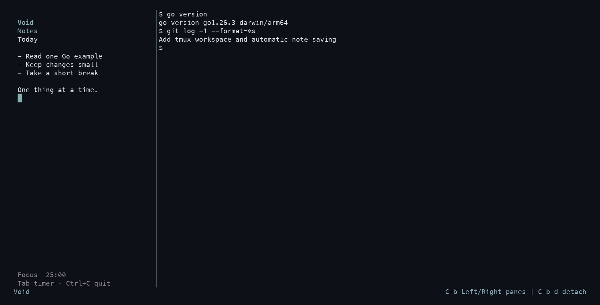

# Void

A quiet terminal workspace with persistent notes, a 25-minute focus timer,
and your own shell side by side.



*Demo capture from an isolated tmux session, using example notes.*

## What it does

- Keeps one shared scratchpad between sessions, saving automatically as you type.
- Offers a fixed 25-minute timer with start, pause, resume, and reset.
- Runs your shell in a real tmux pane, including interactive terminal programs.
- Lets you detach and reconnect while your workspace keeps running.

Void is an early personal learning project, developed iteratively with AI coding
assistants and checked through automated tests and hands-on use.

## Install and start

Requires **Go 1.26.3 or newer**, **tmux**, and an interactive terminal on macOS or
Linux. Developed and tested on Apple Silicon macOS with tmux 3.8.

Install tmux with `brew install tmux` on macOS or `sudo apt install tmux` on
Debian/Ubuntu, then build Void:

```sh
git clone https://github.com/crnly/void.git
cd void
go install .
```

Go installs the command into `GOBIN`, or into `~/go/bin` by default. If needed,
add that directory to your shell's `PATH`:

```sh
export PATH="$HOME/go/bin:$PATH"
```

Run `void` from the directory where you want to work, **outside tmux**. The first
launch opens a 36-column sidebar and starts your shell on the right. Subsequent
launches reconnect to that same workspace, keeping its current directory.

For development, `go run .` starts the workspace from the repository.

## Controls

Press the tmux prefix **Ctrl+B**, release it, then press the next key.

| Where | Keys | Action |
| --- | --- | --- |
| Workspace | Ctrl+B, then Left / Right | Switch panes |
| Workspace | Ctrl+B, then D | Detach; keep the workspace running |
| Sidebar | Tab | Switch between notes and timer |
| Timer | Space | Start, pause, or resume |
| Timer | R | Reset to 25:00 and stop |
| Timer | Esc | Return to notes |
| Sidebar | Ctrl+C | Save pending notes and close the sidebar |
| Shell | Normal shell keys | Work normally, including Tab and Ctrl+C |

Run `void` again to reconnect after detaching. **Ctrl+C in the sidebar closes
only that pane.** Currently, it is not recreated on reconnect: finish any running
shell work, exit the remaining shell, and start Void again for a fresh workspace.

## Notes and timer behavior

Notes save after a 500 ms writing pause and on normal sidebar shutdown. A new
session restores the same text. Files are local to your machine and live outside
the repository:

- macOS: `~/Library/Application Support/void/notes.md`
- Linux: `$XDG_CONFIG_HOME/void/notes.md`, or `~/.config/void/notes.md`

Writes use a temporary file and an atomic rename. File errors are shown in the
sidebar; a read error disables saving for that session to preserve the file.
There is one shared note, so avoid running several editor-only instances at once.
Forced termination can lose edits still within the short writing pause.

The timer measures actual elapsed time and continues while you edit notes or
detach. A new sidebar process starts at 25:00; an existing process keeps its timer
state. A completed session must be reset before starting again.

Void uses a separate `tmux -L void` server with its own embedded configuration.
Your regular tmux configuration and sessions are not changed. Nested tmux starts
are rejected with a message.

## Development

Built with Go, [Bubble Tea](https://github.com/charmbracelet/bubbletea),
[Bubbles](https://github.com/charmbracelet/bubbles),
[Lip Gloss](https://github.com/charmbracelet/lipgloss), and
[tmux](https://github.com/tmux/tmux).

| File | Responsibility |
| --- | --- |
| `main.go` | Notes editor, focus routing, autosave, and rendering |
| `storage.go` | Loading and atomically saving notes |
| `timer.go` | Countdown state and tick handling |
| `workspace.go` | tmux startup and reconnecting |

```sh
go test ./...
go vet ./...
go build -o /tmp/void .
```

Tests cover storage, autosave, timer transitions, and tmux startup/reconnects.
Storage tests use temporary files; integration tests use their own tmux servers
and a harmless sidebar fixture. They do not open personal notes or the running
Void workspace. tmux tests are skipped when tmux is unavailable.
